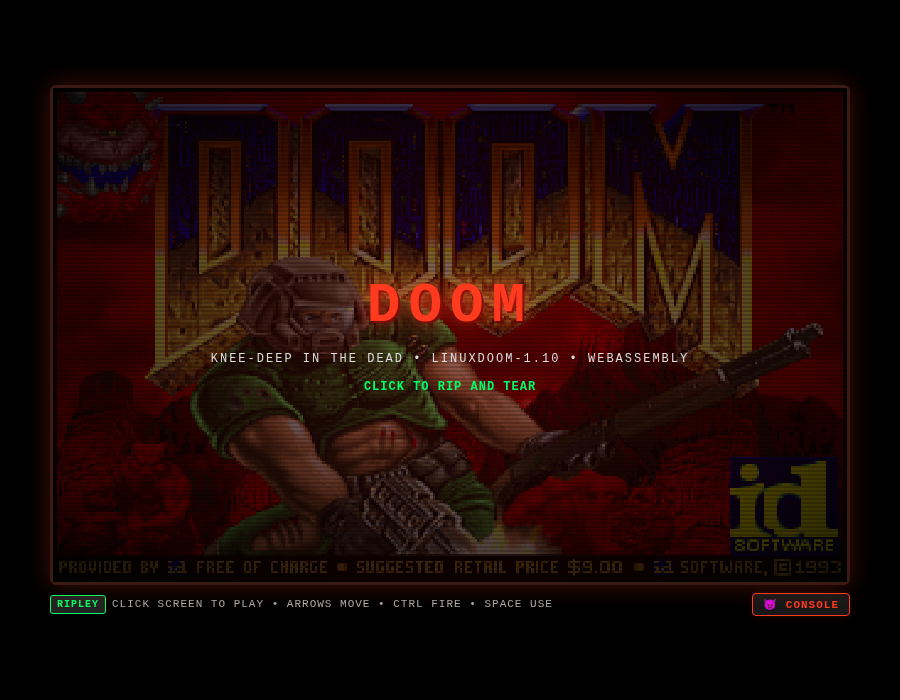
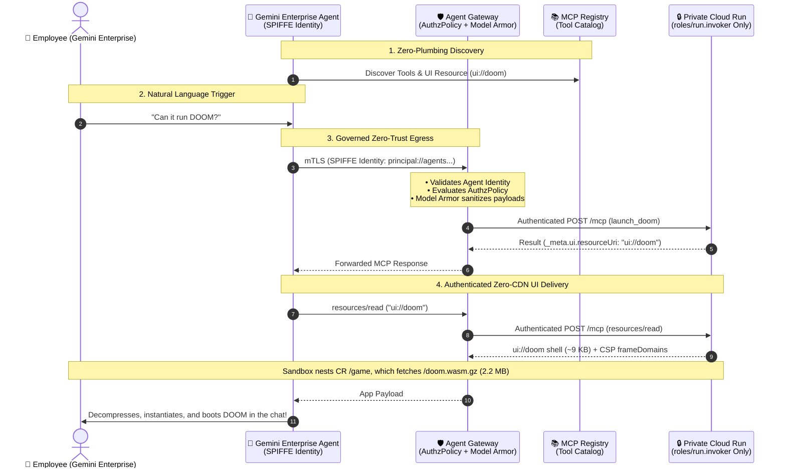

# 👹 DOOM — Secure Enterprise MCP App for Gemini Enterprise

Yes, it runs DOOM. The original 1993 engine (`linuxdoom-1.10`, compiled to WebAssembly) packaged as a **Model Context Protocol (MCP) App** (UI Extension) to showcase secure, governed application execution inside the **Gemini Enterprise Agent Platform (GEAP)**.

When a user in Gemini Enterprise asks:
> *"Can it run DOOM?"* or *"Launch DOOM"*

Gemini executes the MCP server's `launch_doom` tool. The response returns an interactive UI resource URI (`ui://doom`), prompting Gemini Enterprise to render a small HTML shell in its sandboxed iframe. The shell owns the MCP Apps bridge and nests the real game page from this server in a second iframe, declared through the resource's `_meta.ui.csp.frameDomains`. That indirection is not optional: MCP Apps hosts build the sandbox Content-Security-Policy without `wasm-unsafe-eval`, so WebAssembly cannot be compiled inside the resource itself (the symptom is `BOOT FAILED: CompileError`). In the nested page, served from our own origin, the browser fetches the gzip-compressed engine **and** shareware IWAD, inflates them with `DecompressionStream`, and instantiates the module. Nothing is fetched from a CDN. Users play in the chat thread while the agent drives DOOM's own menus and types genuine id Software cheat codes (**IDDQD**, **IDKFA**, **IDSPISPOPD**, **IDCLEV**) into the engine's input queue.



---

## 🏛️ Why GEAP? The 4 Pillars of Governed MCP Apps



### 1. Centralized Catalog via MCP Registry
Eliminates brittle webhooks and connector sprawl. Services publish schemas, interfaces, and `_meta.ui` tags centrally so agents discover tools dynamically.

### 2. Zero-Trust Ingress & Private Workloads
Backend Cloud Run services run private (`--no-allow-unauthenticated`). Ingress is restricted to verified Google Cloud OIDC tokens from authorized Service Agents (`gcp-sa-discoveryengine`, `gcp-sa-agentgateway`).

### 3. Deep Egress Governance & Model Armor
Outbound tool calls route through **Agent Gateway**:
- **Identity Gate (`REQUEST_AUTHZ`):** Enforces cryptographic SPIFFE identities (`principal://agents.global...`) over mTLS with fine-grained tool authorization policies.
- **Payload Inspection (`CONTENT_AUTHZ`):** Model Armor inspects and sanitizes tool arguments in flight, defending against prompt injections and malicious parameter tampering.

### 4. Zero-CDN Secure UI Delivery
The entire game, HTML shell plus a 2.2 MB gzipped WebAssembly module with the IWAD linked in, is delivered through the authenticated MCP channel (`resources/read`) and runs inside a sandboxed iframe with dynamic `postMessage` origin locking. No external CDN dependencies, no second fetch the sandbox would have to be allowed to make, no asset tampering surface.

---

## 🎮 Features & MCP Tools

| Tool / Capability | Description | Input Parameters |
| :--- | :--- | :--- |
| **`launch_doom`** | Boots DOOM inside the chat thread. Title screen and demo loop play until the user clicks. | *(none)* |
| **`start_new_game`** | Drives DOOM's menu (Esc → New Game → Knee-Deep in the Dead → skill) to start E1M1. | `skill`: `im_too_young_to_die`, `hey_not_too_rough`, `hurt_me_plenty` (default), `ultra_violence`, `nightmare` |
| **`trigger_doom_cheat`** | Types a real id Software cheat into the engine. Starts a game first if still on the title screen. | `cheat`: `god_mode` (IDDQD), `all_weapons_and_keys` (IDKFA), `all_weapons` (IDFA), `no_clip` (IDSPISPOPD), `chainsaw` (IDCHOPPERS), `invulnerability`, `berserk`, `partial_invisibility`, `radiation_suit`, `computer_map`, `light_amp` (IDBEHOLD*), `show_position` (IDMYPOS) |
| **`warp_to_level`** | Types `IDCLEV1x` to jump to any Episode 1 map. | `map` (1–9; 9 is the secret level Military Base) |
| **`ui://doom`** *(Resource)* | Small shell that runs the MCP Apps bridge and nests `/game` (the engine, keyboard bridge, and an in-app console mirroring the tools) from this server. | *(text/html;profile=mcp-app, `_meta.ui.csp.frameDomains`)* |

Every tool result carries `_meta.ui.resourceUri: "ui://doom"`, so the MCP Apps host forwards the JSON payload into the running iframe, where it is turned into key events on DOOM's input queue (`add_browser_event`). The cheats are therefore not re-implemented: DOOM itself prints *Degreelessness Mode On*.

**Controls:** arrows move, `Ctrl` fires, `Space` opens doors, `Alt` + arrows strafe, `Shift` runs, `Tab` automap, `Esc` menu, `1`–`7` weapons. The **CONSOLE** button below the screen exposes the same skill picker, cheats, and warps as the tools. This build has no sound.

---

## 🔐 Standards-Compliant Cloud-Agnostic OAuth 2.0

Includes a built-in, zero-dependency OAuth 2.0 authorization server (RFC 6749 & RFC 7636):
- **Authorization Code Flow with PKCE (`S256` & `plain`)**: Compatible with Gemini Enterprise, Discovery Engine, Claude Desktop, Cursor, and enterprise MCP proxies.
- **Client Credentials & Token Rotation**: Supports direct server-to-server integrations with automatic cryptographic token rotation.
- **Cloud-Agnostic Portability**: Built entirely with native Node.js `crypto` primitives — portable to Google Cloud Run, AWS App Runner, Azure Container Apps, or Kubernetes without vendor lock-in.

---

## 🚀 Deployment & Connection Topologies

The DOOM MCP App supports two connection topologies:

1. **Governed Enterprise Gateway (Target Architecture for GEAP):** The production-grade zero-trust pattern. Invocations route through Google Cloud **Agent Gateway** and **MCP Registry**, enforcing cryptographic SPIFFE agent identities over mTLS, fine-grained `AuthzPolicy` tool permissions, and in-flight payload sanitization via **Model Armor**.
2. **Direct Connection (Custom MCP):** A streamlined connection directly between Gemini Enterprise and Cloud Run via OAuth 2.0 PKCE (`S256`). Ideal for rapid prototyping, standalone demonstrations, or environments evaluating MCP Apps prior to configuring gateway policies.

> [!NOTE]
> See [docs/GEAP_ENTERPRISE_SETUP.md](docs/GEAP_ENTERPRISE_SETUP.md) for full architectural guides and step-by-step setup instructions for both deployment topologies.

> [!IMPORTANT]
> The host must honour `_meta.ui.csp.frameDomains` (part of the MCP Apps spec) for the nested game frame to load. If it does not, the shell shows a diagnostic after 25 s with a direct link to `/game`. The server derives its public origin from the request (`X-Forwarded-Proto` + `Host`, so it works behind Cloud Run); set `PUBLIC_BASE_URL` to override it when a gateway rewrites the host.

### Prerequisites
- Node.js 20+ and npm (`node -v`, `npm -v`)
- Google Cloud SDK (`gcloud`) installed and authenticated (`gcloud auth login`)
- Target GCP project with Cloud Run Admin API (`run.googleapis.com`) and Cloud Build API (`cloudbuild.googleapis.com`) enabled

```bash
# Set environment variables
export PROJECT_ID="<YOUR_PROJECT_ID>"
export REGION="us-central1"
export SERVICE_NAME="mcp-doom"
export PROJECT_NUMBER=$(gcloud projects describe $PROJECT_ID --format='value(projectNumber)')
```

### Quick Start (Google Cloud Run)
```bash
# 1. Deploy private Cloud Run service
gcloud run deploy $SERVICE_NAME \
  --source . \
  --region $REGION \
  --project $PROJECT_ID \
  --no-allow-unauthenticated \
  --port 8080

# 2. Grant Invoker role to Discovery Engine Service Agent
gcloud run services add-iam-policy-binding $SERVICE_NAME \
  --member="serviceAccount:service-${PROJECT_NUMBER}@gcp-sa-discoveryengine.iam.gserviceaccount.com" \
  --role="roles/run.invoker" \
  --region=$REGION \
  --project=$PROJECT_ID
```

> [!NOTE]
> When integrating with Agent Gateway (Governed mode), ensure your gateway's service agent or caller identity is also granted `roles/run.invoker`.

### 3. Connect in Gemini Enterprise Console (Direct Custom MCP)

1. Open **Google Cloud Console** &rarr; **Agent Builder** (or **Gemini Enterprise**) &rarr; **Data Stores** &rarr; **Create Data Store**.
2. Select **Custom MCP** (or **Model Context Protocol**).
3. Configure the connection:
   - **Data Store Name / ID:** `doom-mcp-direct`
   - **MCP Server URL:** `https://<CLOUD_RUN_URL>/mcp`
   - **Authentication:** `OAuth 2.0`
   - **Authorization URL:** `https://<CLOUD_RUN_URL>/authorize`
   - **Token URL:** `https://<CLOUD_RUN_URL>/token`
   - **Client ID:** `gemini-enterprise-agent`
   - **Client Secret:** `secret123` (or any placeholder string)
   - **PKCE Support:** ☑️ **Enabled (`S256`)**
4. Click **Verify Auth** (approve in the popup window) &rarr; **Create**.
5. Attach the Data Store to your **Gemini Enterprise Agent** under **Actions / Tools**, save, and ask: *"Can it run DOOM?"*

---

## 💻 Local Development

```bash
# Install dependencies
npm install

# Build TypeScript and stage the game assets (shell.html, index.html, doom.wasm.gz) into dist/
npm run build

# Unit tests for the tool layer (node:test)
npm test

# Start local server (production mode)
npm start

# Or run with live reloading (development mode)
npm run dev

# Endpoints:
# • Health Check:     http://localhost:8080/
# • MCP SSE:          http://localhost:8080/mcp
# • MCP JSON-RPC:     http://localhost:8080/mcp (POST)
# • OAuth 2.0 PKCE:   http://localhost:8080/authorize & /token
# • Direct Preview:   http://localhost:8080/game
```

### How the engine gets into the resource

`src/game/doom.wasm.gz` is the prebuilt `linuxdoom-1.10` WebAssembly module from [diekmann/wasm-fizzbuzz](https://github.com/diekmann/wasm-fizzbuzz) (clang `wasm32`, no emscripten) with `doom1.wad` linked in, gzip-compressed from 6.8 MB to 2.2 MB. The server serves it verbatim at `/doom.wasm.gz`, and `/game` fetches it at boot (an earlier revision inlined it as base64 into the resource; that was dropped because the resource sandbox cannot compile WebAssembly anyway). `scripts/fetch-doom-wasm.sh` re-downloads the upstream binary, verifies its SHA-256, and regenerates the `.gz`.

The page exposes `window.__doom` (`newGame(skill)`, `cheat(code)`, `state`) for headless verification.

---

## 📄 Licensing

- This repository's own code: Apache 2.0.
- DOOM engine (`linuxdoom-1.10`, compiled into `doom.wasm.gz`): GPL-2.0, © id Software.
- `doom1.wad` (shareware Episode 1, linked into the binary): freely redistributable shareware from id Software, **not** open source. Do not replace it with a commercial IWAD.
